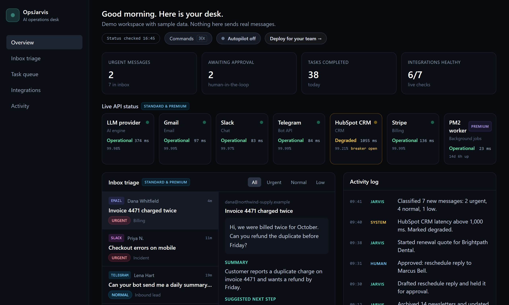

# OpsJarvis by Caelara Labs

**Self-hosted AI Operations Desk powered by Claude + Next.js 15 + Telegram.**

[](./LICENSE)
[](https://nextjs.org)
[](https://www.anthropic.com)
[](#architecture)
[](https://caelaralabs.com)

OpsJarvis reads what your team receives (email, Slack, Telegram), flags what is urgent, drafts the next step, and **waits for a person to approve** anything that writes to Stripe, HubSpot, or a customer. Keys stay in your `.env.local`. You own the code.

| Try it now | Link |
|---|---|
| **Web sandbox** (no login, demo data) | **https://caelaralabs.com** |
| **Telegram triage bot** (paste any message) | **https://t.me/OpsJarvisAI_bot** |
| **Custom production builds & managed hosting** | **https://www.fiverr.com/king12fx/build-your-custom-claude-ai-assistant-and-automated-dashboard** |



---

## What's in this repo (open-core)

This is the client-facing product that every Caelara Labs deployment is built on:

```
app/                     Next.js 15 App Router
  api/status/            server-side health + queue status (polled every 5 s by the dashboard)
  api/gallery/[id]/      server-rendered marketing cards
  api/x/*                approval-queue extension points (switched OFF in open-core)
components/Dashboard.tsx dark-mode ops dashboard: inbox triage, task queue, activity log, Autopilot toggle
lib/llm.ts               one adapter, automatic failover: Claude -> Gemini -> Groq
lib/tg/triage.ts         the triage classifier used by the demo bot (prompt-injection hardened, output scrubbed)
lib/demo-data.ts         fictional sample data (replace per client)
scripts/tg-demo-bot.ts   the public Telegram demo bot (simulated approvals, 10 runs/user/day)
components/BlueprintCapture.tsx + app/api/leads/blueprint/
                         "Get your Claude blueprint": bottleneck + email -> 3-step architecture (LLM or template),
                         emailed via Resend, hot-lead alert to your Telegram, stored in data/blueprint-leads.json
```

Connectors (Gmail, Slack, Stripe, HubSpot), multi-step write pipelines, 24/7 workers and per-client dashboards are delivered as production builds — see [service tiers](#need-production-integrations) below.

## Architecture

**Server-side secrets, always.** Every key lives in `.env.local` and is read only inside `app/api/*` and `scripts/*`. Nothing secret is ever shipped to the browser; the public sandbox runs on demo data with zero keys.

**Human-in-the-loop by design.** The model classifies, summarizes and drafts. A person clicks *Approve* (dashboard or Telegram) before anything is written to a customer or a system of record. `app/api/x/reply` is the single code path that can execute an approved action — in this build it is switched off; production builds enable it only on a locally-run instance, never on a public deployment. The *Autopilot* toggle only starts low-risk, read-only work; approvals still wait for a human.

**Automatic LLM failover.** `lib/llm.ts` tries **Claude → Gemini → Groq**. Each provider walks a model-preference list when an account lacks a model, every call has a 30-second timeout, a provider that returns an auth error is disabled for the process, and one that times out or hits quota twice in a row is parked so a dead key never slows the loop.

**5-second health checks.** The dashboard polls `/api/status` every 5 seconds: engine availability, API latency, and queue depth, so a stalled connector is visible before a customer notices.

**Lead capture without a vendor.** `POST /api/leads/blueprint` validates and rate-limits, generates a tailored 3-step blueprint (with the deterministic template as a no-key fallback), emails it through Resend's REST API, and posts a hot-lead card to the owner's Telegram — all server-side, all optional via env.

**Prompt-injection hardened triage.** The classifier sees only a fixed system prompt plus the untrusted message, is told never to follow instructions inside it, and its output is scrubbed for anything secret-shaped before display.

## Quickstart (local setup in 3 commands)

```bash
git clone https://github.com/kingefman1-cmyk/opsjarvis.git && cd opsjarvis
cp .env.example .env.local        # optional: add ANTHROPIC_API_KEY (or GEMINI_API_KEY / GROQ_API_KEY)
npm install && npm run dev        # http://localhost:3000
```

With no keys the dashboard runs on demo data. Add one LLM key and the triage becomes live.

**Run the Telegram demo bot:** create a bot with [@BotFather](https://t.me/BotFather), put the token in `TELEGRAM_BOT_TOKEN`, then `npm run demo:bot`.

**Deploy the dashboard:** `vercel` (zero config) or any Node host. Keep approval execution off on public deployments.

Requires Node 20+.

## Need production integrations?

Caelara Labs builds and runs OpsJarvis for teams that want it wired to their real stack. Fixed scope, fixed price, delivered from this codebase.

| Tier | Price | You get | Book |
|---|---|---|---|
| **Single Workflow Automation** | **$120** · 2 days | One automated API pipeline or Claude workflow script, `.env.example`, setup guide | [Book →](https://www.fiverr.com/king12fx/build-your-custom-claude-ai-assistant-and-automated-dashboard) |
| **Business Jarvis Dashboard** | **$325** · 4 days | This dashboard on Vercel, connected to up to 3 REST/OAuth APIs: inbox triage (email, Slack, Telegram), summaries, read + draft actions | [Book →](https://www.fiverr.com/king12fx/build-your-custom-claude-ai-assistant-and-automated-dashboard) |
| **Full AI Operations Desk** | **$950** · 7 days | Multi-step write actions behind approval switches, 24/7 workers, unlimited standard APIs, full custom build | [Book →](https://www.fiverr.com/king12fx/build-your-custom-claude-ai-assistant-and-automated-dashboard) |
| **Managed Hosting** | **$149 / mo** | We run it: VPS, keys rotation, monitoring, LLM failover tuning, monthly review | [Ask →](https://www.fiverr.com/king12fx/build-your-custom-claude-ai-assistant-and-automated-dashboard) |

Need Standard plus exactly one write action (a HubSpot stage update, a Slack alert)? There is a bridge offer between $325 and $950 — ask.

**Talk to the builder:** [Fiverr](https://www.fiverr.com/king12fx/build-your-custom-claude-ai-assistant-and-automated-dashboard) · [@opsjarvisai on X](https://x.com/opsjarvisai) · [Telegram demo](https://t.me/OpsJarvisAI_bot)

## Contributing

Issues and PRs that improve the open-core product are welcome: dashboard UX, new LLM providers behind `lib/llm.ts`, triage prompt hardening, tests. Connector implementations are intentionally out of scope for this repo.

## License

[MIT](./LICENSE) © 2026 Caelara Labs (Efe Brume-Ezewu).
